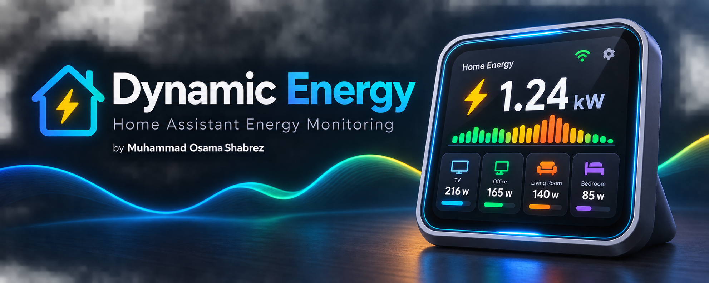

  

# Dynamic Energy Monitor

Home Assistant custom integration for monitoring household energy consumption and dynamically ranking the top four power-consuming devices.

## Features

- Aggregate current power consumption
- Aggregate monthly energy consumption
- Persistent monthly energy accounting
- Support for monthly-reset and cumulative energy sensors
- Dynamic top-four consumer ranking with configurable hysteresis
- Custom panel for managing power sources and monitoring settings

## Installation

### HACS

1. Open HACS in Home Assistant.
2. Open **Integrations**.
3. Open the three-dot menu and select **Custom repositories**.
4. Add `https://github.com/OsamaShabrez/dynamic_energy` as an **Integration**.
5. Click **Add**.
6. Find **Dynamic Energy Monitor** in HACS and download it.
7. Restart Home Assistant.

### Manual

1. Copy the `custom_components/dynamic_energy` directory into your Home Assistant `custom_components` directory.
2. Restart Home Assistant.

## Installation

If the repository is not yet available in the HACS default repository list, add it as a custom repository:

1. Open **HACS → Integrations**
2. Open the **⋮** menu
3. Select **Custom repositories**
4. Add `https://github.com/osamashabrez/dynamic_energy`
5. Select **Integration**
6. Install **Dynamic Energy**

Then add **Dynamic Energy** from:

**Settings → Devices & services → Add integration**

## Configuration

Open the Dynamic Energy panel to add and configure your power sources.

## Entities

- `sensor.apartment_current_power`
- `sensor.apartment_energy_month`
- `sensor.top_consumer_1`
- `sensor.top_consumer_2`
- `sensor.top_consumer_3`
- `sensor.top_consumer_4`
